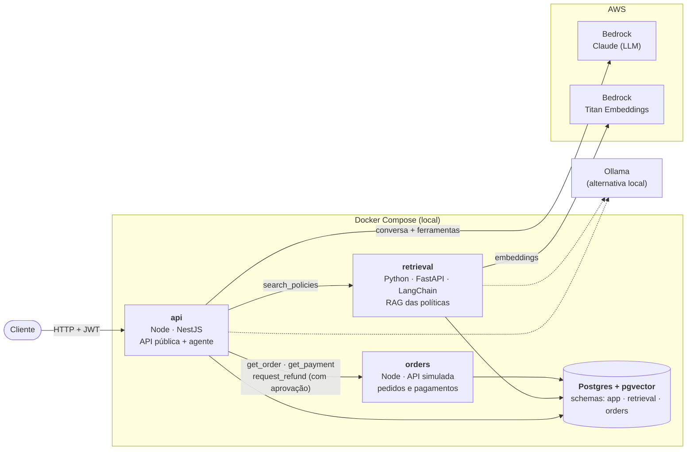

# post-sale-agent

Assistente de pós-venda para e-commerce construído com um **agente de IA**: o cliente pergunta
sobre pedidos, pagamentos e políticas da loja, e o agente decide quais ferramentas usar
(consultar um pedido, buscar na política de trocas, solicitar um estorno). Ações que mudam
alguma coisa, como um estorno, **só executam depois da aprovação do cliente**.

Projeto de estudo e portfólio, com foco em backend: orquestração de agentes, integração com
LLMs (Amazon Bedrock), RAG, contratos entre serviços, segurança e observabilidade.

> 🚧 Em construção. O desenvolvimento segue **Spec-Driven Development** com
> [OpenSpec](https://openspec.dev): cada funcionalidade começa como uma especificação em
> `openspec/changes/`, revisada antes do código, e entra por um PR próprio.

## Arquitetura



| Serviço | Stack | Responsabilidade |
|---|---|---|
| `api` | Node.js, NestJS | API pública, autenticação, orquestração do agente, guardrails, aprovação humana |
| `retrieval` | Python, FastAPI, LangChain | Ingestão e busca semântica nas políticas da loja (RAG) |
| `orders` | Node.js | Simula o sistema de pedidos e pagamentos de um terceiro |
| `postgres` | PostgreSQL + pgvector | Dados relacionais e vetoriais, um schema por serviço |

Os contratos entre os serviços ficam em [`contracts/`](contracts/) no formato OpenAPI.

## Estrutura

```
post-sale-agent/
├── openspec/            # especificações (Spec-Driven Development)
├── services/
│   ├── api/             # Node.js + NestJS
│   ├── retrieval/       # Python + FastAPI
│   └── orders/          # Node.js (API simulada)
├── contracts/           # contratos OpenAPI entre os serviços
├── infra/postgres/      # inicialização do banco (schemas e usuários)
└── docker-compose.yml
```

## Como rodar

Pré-requisitos: Docker (ou OrbStack) e [Ollama](https://ollama.com) instalado na máquina host,
com o modelo baixado (`ollama pull qwen2.5:7b`). O Ollama fica fora do Compose para usar a GPU;
detalhes em [`services/api`](services/api/README.md#provedores-de-llm).

### 1. Configurar os segredos

O Compose lê tudo de um único `.env` na raiz, que fica fora do git. Ele precisa de senhas e chaves
aleatórias; nenhuma vem preenchida, e sem elas o Compose se recusa a subir.

```bash
cp .env.example .env
```

Preencha cada valor vazio. Um jeito rápido de gerar valores aleatórios é o `openssl`:

| Variável | O que é | Como gerar |
|---|---|---|
| `POSTGRES_PASSWORD` | Superusuário do Postgres (só cria schemas e usuários) | `openssl rand -hex 16` |
| `APP_DB_PASSWORD`, `ORDERS_DB_PASSWORD`, `RETRIEVAL_DB_PASSWORD` | Usuário de banco de cada serviço | `openssl rand -hex 16` (um para cada) |
| `ORDERS_API_KEY` | Chave que a `api` usa para chamar o `orders` | `openssl rand -hex 16` |
| `RETRIEVAL_API_KEY` | Chave que a `api` usa para chamar o `retrieval` | `openssl rand -hex 16` |
| `JWT_SECRET` | Segredo que assina os tokens dos clientes | `openssl rand -hex 32` |

As senhas do banco são aplicadas só na primeira subida do Postgres. Para trocá-las depois, é preciso
recriar o volume (`docker compose down -v`, que apaga os dados).

Para rodar um serviço **fora** do Docker (ex.: `npm run start:dev`), cada pasta em `services/` tem o
seu `.env.example`; os valores devem ser os mesmos do `.env` da raiz.

### 2. Subir

```bash
docker compose up -d
docker compose ps          # todos os serviços devem aparecer como "healthy"
```

| Serviço | Porta | Status | Documentação |
|---|---|---|---|
| `postgres` | 5432 | pronto | [`infra/postgres`](infra/postgres/init/01-schemas.sh) |
| `orders` | 3002 | pronto | [`services/orders`](services/orders/README.md) |
| `api` | 3000 | pronto | [`services/api`](services/api/README.md) · Swagger em http://localhost:3000/docs |
| `retrieval` | 8000 | em construção | |
