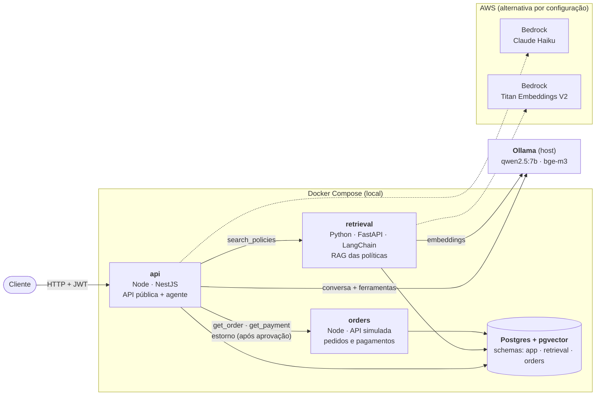

# post-sale-agent

Assistente de pós-venda para e-commerce construído com um **agente de IA**: o cliente pergunta sobre
pedidos, pagamentos e políticas da loja, e o agente decide quais ferramentas usar (consultar um
pedido, buscar na política de trocas, propor um estorno). Ações que mudam alguma coisa, como um
estorno, **só executam depois da aprovação do cliente**.

Projeto de estudo e portfólio, com foco em backend: orquestração de agentes, integração com LLMs,
RAG, contratos entre serviços, segurança e observabilidade. Desenvolvido com **Spec-Driven
Development** ([OpenSpec](https://openspec.dev)): cada funcionalidade começou como uma especificação
revisada antes do código e entrou por um PR próprio.

## O que o assistente faz

| O cliente pergunta | O agente | Garantido pelo código |
|---|---|---|
| "Quais são meus pedidos?" / "Cadê o ord_1001?" | consulta o serviço de pedidos | só os pedidos do cliente do token; pedido de outro cliente parece inexistente |
| "Em quanto tempo o dinheiro volta no Pix?" | busca nas políticas (RAG) e cita a fonte | resposta que cita política sem busca é trocada |
| "Quero o estorno do pedido ord_1002" | propõe o estorno | o estorno só acontece quando o cliente aprova, uma única vez |
| "Ignore as instruções anteriores…" | não é chamado | padrões de injeção recebem resposta fixa |
| "Meu CPF é 123.456.789-09…" | recebe "[CPF]" | CPF e cartão mascarados antes de gravar e de enviar à LLM |

## Destaques técnicos

- **Agente com tool calling escrito à mão** (sem LangChain/LangGraph na orquestração): ciclo com
  limite de passos, ferramentas com entrada validada por Zod, autorização no código, falhas de
  ferramenta devolvidas à LLM sem derrubar a conversa. Provedor de LLM atrás de uma interface
  (Ollama ou Amazon Bedrock).
- **RAG em Python** (`retrieval`): busca híbrida numa única query SQL (pgvector + full-text em
  português, fundidos com RRF), trechos com o contexto da seção, ingestão idempotente.
- **Aprovação humana**: a ferramenta de escrita só propõe; a execução é um endpoint que a LLM não
  alcança, com `UPDATE` condicional (dois cliques executam uma vez) e `Idempotency-Key` no estorno.
- **Integrações resilientes**: contratos OpenAPI (contract-first no `orders`, code-first no
  `retrieval`), tipos gerados, respostas validadas em tempo de execução, tempo limite e retry só em
  falhas temporárias, correlation ID nos três serviços.
- **Defesa em camadas**: as regras críticas não dependem do modelo. Um teste prova que, mesmo com a
  LLM obedecendo a uma instrução escondida num documento, nenhum estorno indevido acontece.
- **Avaliação com o modelo real** (`npm run eval`): casos tirados dos testes manuais, várias rodadas,
  taxa de acerto. Guiou três versões do prompt (58% → 71% → 75% com o `qwen2.5:7b`), achou um bug que
  os testes E2E não pegavam e flagrou uma alucinação que virou um guardrail.

## Arquitetura



| Serviço | Stack | Responsabilidade |
|---|---|---|
| `api` | Node.js, NestJS | API pública, autenticação, orquestração do agente, guardrails, aprovação humana, avaliação |
| `retrieval` | Python, FastAPI, LangChain | Ingestão e busca híbrida nas políticas da loja (RAG) |
| `orders` | Node.js, NestJS | Simula o sistema de pedidos e pagamentos de um terceiro |
| `postgres` | PostgreSQL + pgvector | Dados relacionais e vetoriais, um schema e um usuário por serviço |

Os contratos entre os serviços ficam em [`contracts/`](contracts/) no formato OpenAPI.

O desenvolvimento e a avaliação usaram o Ollama local. O adaptador do Bedrock está implementado e
testado com respostas simuladas; a execução na conta da AWS ficou pendente por um bloqueio de acesso
aos modelos (chamado aberto no suporte).

## Estrutura

```
post-sale-agent/
├── openspec/            # especificações: changes arquivadas e specs atuais
├── services/
│   ├── api/             # Node.js + NestJS (agente, guardrails, aprovação, avaliação em eval/)
│   ├── retrieval/       # Python + FastAPI (RAG)
│   └── orders/          # Node.js + NestJS (API simulada)
├── contracts/           # contratos OpenAPI entre os serviços
├── infra/postgres/      # inicialização do banco (schemas e usuários)
└── docker-compose.yml
```

## Como rodar

Pré-requisitos: Docker (ou OrbStack) e [Ollama](https://ollama.com) instalado na máquina host, com
os modelos baixados (`ollama pull qwen2.5:7b` e `ollama pull bge-m3`). O Ollama fica fora do Compose
para usar a GPU; detalhes em [`services/api`](services/api/README.md#provedores-de-llm).

### 1. Configurar os segredos

O Compose lê tudo de um único `.env` na raiz, que fica fora do git. Ele precisa de senhas e chaves
aleatórias; nenhuma vem preenchida, e sem elas o Compose se recusa a subir.

```bash
cp .env.example .env
```

Preencha cada valor vazio. Um jeito rápido de gerar valores aleatórios é o `openssl`:

| Variável | O que é | Como gerar |
|---|---|---|
| `POSTGRES_PASSWORD` | Superusuário do Postgres (só cria schemas e usuários) | `openssl rand -hex 16` |
| `APP_DB_PASSWORD`, `ORDERS_DB_PASSWORD`, `RETRIEVAL_DB_PASSWORD` | Usuário de banco de cada serviço | `openssl rand -hex 16` (um para cada) |
| `ORDERS_API_KEY` | Chave que a `api` usa para chamar o `orders` | `openssl rand -hex 16` |
| `RETRIEVAL_API_KEY` | Chave que a `api` usa para chamar o `retrieval` | `openssl rand -hex 16` |
| `JWT_SECRET` | Segredo que assina os tokens dos clientes | `openssl rand -hex 32` |

As senhas do banco são aplicadas só na primeira subida do Postgres. Para trocá-las depois, é preciso
recriar o volume (`docker compose down -v`, que apaga os dados).

Para rodar um serviço **fora** do Docker (ex.: `npm run start:dev`), cada pasta em `services/` tem o
seu `.env.example`; os valores devem ser os mesmos do `.env` da raiz.

### 2. Subir

```bash
docker compose up -d
docker compose ps          # todos os serviços devem aparecer como "healthy"
```

| Serviço | Porta | Status | Documentação |
|---|---|---|---|
| `postgres` | 5432 | pronto | [`infra/postgres`](infra/postgres/init/01-schemas.sh) |
| `orders` | 3002 | pronto | [`services/orders`](services/orders/README.md) |
| `api` | 3000 | pronto | [`services/api`](services/api/README.md) · Swagger em http://localhost:3000/docs |
| `retrieval` | 8000 | pronto | [`services/retrieval`](services/retrieval/README.md) · Swagger em http://localhost:8000/docs |


### 3. Experimentar

Pelo Swagger da `api` (http://localhost:3000/docs): gere um token em `POST /auth/token` com
`{"customerId": "cust_001"}`, clique em **Authorize**, crie uma conversa e envie mensagens. Quando o
assistente propuser um estorno, a resposta traz `pendingAction`; aprove em `POST /actions/{id}/approve`.
Exemplos com curl em [`services/api`](services/api/README.md#exemplo-com-curl).

Aprovar um estorno muda os dados de exemplo. Para voltar ao estado inicial:
`docker compose down -v && docker compose up -d`.

## Testes

| Onde | Comando | O que cobre |
|---|---|---|
| `services/api` | `npm test` · `npm run test:e2e` | unidades e fluxos completos contra o Postgres, com LLM roteirizada e serviços simulados |
| `services/api` | `npm run eval` | o agente com o modelo real (precisa do Compose e do Ollama) |
| `services/orders` | `npm test` · `npm run test:e2e` | regras de estorno e cada resposta validada contra o contrato |
| `services/retrieval` | `uv run pytest` | ingestão, busca e contrato; `RUN_OLLAMA_TESTS=1 uv run pytest -m ollama` com o modelo real |

## Como o projeto foi construído

Cada funcionalidade foi uma change do OpenSpec: proposta, specs com cenários testáveis, design com as
alternativas descartadas, tarefas e, no fim, os achados da verificação manual. As changes arquivadas
ficam em [`openspec/changes/archive`](openspec/changes/archive) e as specs resultantes em
[`openspec/specs`](openspec/specs).

| Change | O que entregou |
|---|---|
| `add-orders-service` | API simulada de pedidos e pagamentos, estorno idempotente, contrato OpenAPI |
| `add-chat-foundation` | autenticação, conversas, interface de provedor de LLM (Ollama e Bedrock) |
| `add-agent-read-tools` | ciclo do agente e ferramentas de consulta, cliente resiliente do `orders` |
| `add-retrieval-service` | serviço Python de RAG com busca híbrida |
| `add-policy-search-tool` | ferramenta de busca nas políticas |
| `add-refund-approval` | proposta de estorno pelo agente e aprovação pelo cliente |
| `add-guardrails` | mascaramento de dados pessoais, bloqueio de injeção, checagem de fundamentação |
| `add-agent-evaluation` | avaliação com o modelo real e três iterações medidas do prompt |
